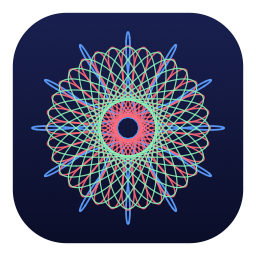
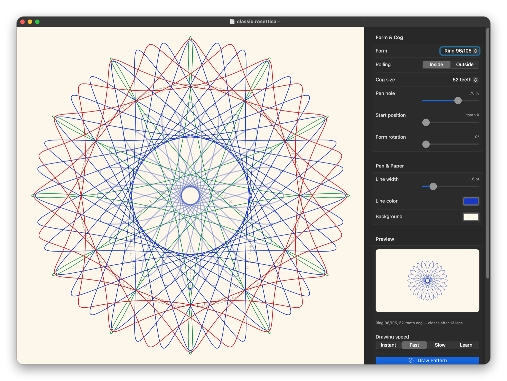
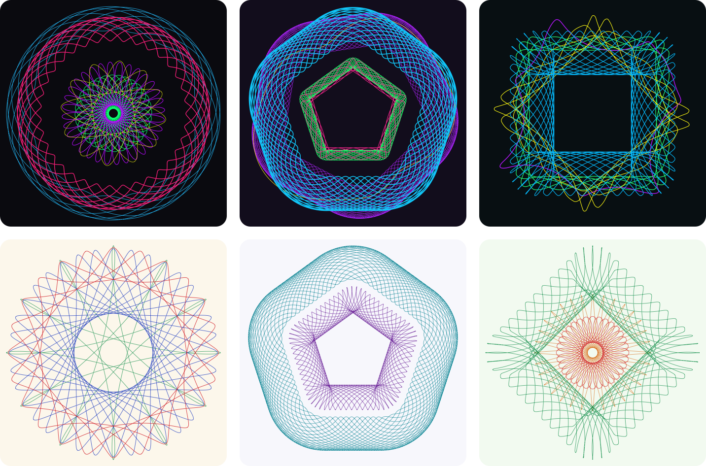
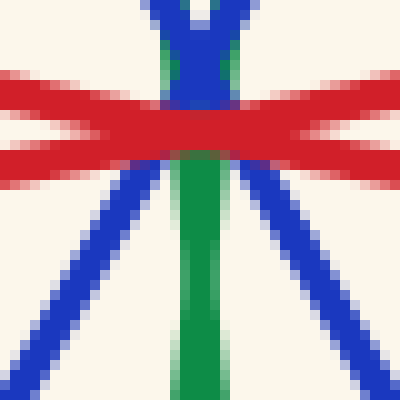
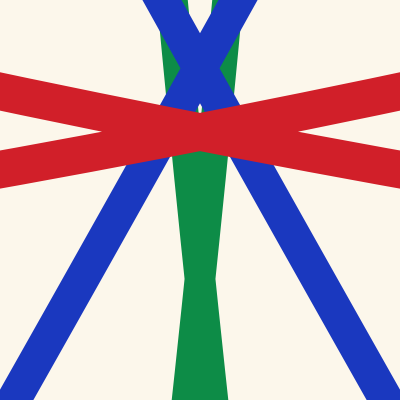
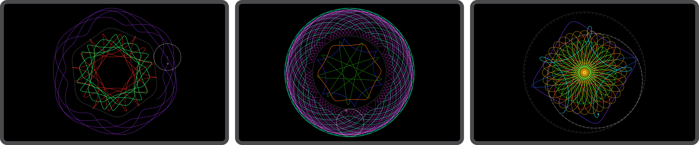

<div align="center">



# Rosettica

**Gear drawing on your Mac.**<br>
Toothed cogs roll inside and around rings and frames while a pen in one of
their holes traces endless rosettes — just like the classic toy, teeth and all.




</div>

## A pure fun project

Rosettica exists because watching a cog roll a rosette onto paper is
mesmerizing, and for no other reason. There is no business model, no account,
no tracking — it does not even use the network.

It is **free to use, modify and redistribute** under the [MIT license](LICENSE).
Take it apart, change it, build something else out of it.

Rosettica is a homage to the gear drawing toy invented by Denys Fisher and
first presented in 1965. It is an independent project and not affiliated with
the makers of the original toy.

## What it does

- **Forms and cogs.** Two rings, a triangle, a square, a pentagon, a hexagon
  and an oval, and sixteen cogs from 24 to 84 teeth. Cogs roll **inside** or
  **outside** each form, and only cogs that would physically fit are offered.
- **Pen and paper.** Pick the pen hole, the starting tooth, the form's rotation,
  the line width and the colors of pen and paper.
- **See it before you draw it.** A translucent preview of the next pattern lies
  on the canvas, with the form and the cog outlined, and the sidebar tells you
  after how many laps the pattern will close.
- **Layer upon layer.** Every pattern you draw becomes a layer. Change the cog,
  the color or the form and draw again — that is where the magic happens.
- **Watch it roll.** At the *Slow* and *Learn* speeds the toothed cog rolls
  along the form tooth by tooth while the pen draws, exactly like the real toy.
  *Learn* is slow enough for children to follow every turn.
- **Random Demo.** Press **⇧⌘R** and the canvas fills itself with random
  compositions in bright colors on black — the same show as the screensaver.
  Your own drawing is not touched.
- **Export.** PNG at 2048 × 2048 pixels, SVG and PDF as exact vector curves,
  and printing.
- **The comfortable basics.** Undo and redo for every step, several drawings
  open side by side, and documents that reopen where you left them.

## Gallery

Three compositions from the Random Demo (top) and three classics in ballpoint
colors on paper (bottom):

<div align="center">

</div>

## SVG and PDF export

A PNG is limited to its resolution. **File → Export → SVG…** and
**File → Export → PDF…** write the drawing as vector artwork instead, so it
stays sharp on a poster or a pen plotter. The curves are not traced from the
picture: Rosettica computes them from the rolling cogs themselves, as smooth
Bézier curves that never stray more than a hundredth of a point from the
mathematically exact line.

| PNG export, magnified 10× | SVG export, magnified 10× |
| :---: | :---: |
|  |  |

## The screensaver

Rosettica comes with a screensaver that draws random compositions in bright
colors on black. You see the toothed cog roll along its form while the pen
draws, layer after layer; the finished picture rests for a moment, fades out,
and a new one begins.

It works with **multiple monitors**: every display draws its own, different
rosettes.

<div align="center">

</div>

## Requirements

- A Mac with an **Apple M-series processor** (Apple silicon)
- macOS 13 Ventura or later

Rosettica is developed and tested on a current macOS; older versions back to
macOS 13 should work but have not been tried.

## Installing

### Download

Get `Rosettica-macos-arm64.dmg` from the [Releases](../../releases/latest)
page and open it. Drag **Rosettica** onto the Applications folder, and
double-click **Rosettica.saver** if you want the screensaver as well.

The app is not notarized by Apple, so macOS blocks a downloaded copy the first
time you open it. Either allow it under **System Settings → Privacy & Security
→ Open Anyway**, or remove the download flag in Terminal:

```sh
xattr -dr com.apple.quarantine /Applications/Rosettica.app
```

### Build it yourself

You need a recent Xcode (Swift 5.9 or newer). There are no other dependencies.

```sh
cd Rosettica                  # your clone of this repository
Scripts/build-app.sh          # → dist/Rosettica.app
Scripts/build-saver.sh        # → dist/Rosettica.saver
Scripts/build-dmg.sh          # → dist/Rosettica-macos-arm64.dmg (builds both first)
```

### Installing the screensaver

Double-click `Rosettica.saver` and let macOS install it, or copy it into your
Screen Savers folder yourself (`Scripts/build-saver.sh --install` does that for
a build of your own). Then pick **Rosettica** in
**System Settings → Screen Saver**.

```sh
cp -R dist/Rosettica.saver ~/Library/Screen\ Savers/
```

A downloaded screensaver needs the same treatment as a downloaded app:

```sh
xattr -dr com.apple.quarantine ~/Library/Screen\ Savers/Rosettica.saver
```

## Getting started

1. Open the app. The preview shows what the current cog will draw.
2. Pick a **Form**, choose **Inside** or **Outside**, and a **Cog size**.
3. Move the **Pen hole**: near the rim gives bold loops, near the center gentle
   waves.
4. Click **Draw Pattern** (⌘D). Then change the cog, color or rotation and draw
   another layer on top.
5. Save your work as a `.rosettica` document, or export it as PNG, SVG or PDF.

The full guide is in the app under **Help → Rosettica Help**. The drawing from
the screenshot is included as [`Examples/classic.rosettica`](Examples/classic.rosettica).

| Shortcut | Action |
| :--- | :--- |
| ⌘N | New drawing |
| ⌘O / ⌘S / ⇧⌘S | Open / Save / Save As |
| ⌘E / ⇧⌘E / ⌥⌘E | Export PNG / SVG / PDF |
| ⌘P | Print |
| ⌘Z / ⇧⌘Z | Undo / Redo |
| ⌘D | Draw the pattern |
| ⇧⌘R | Start or stop the Random Demo |
| ⌘? | Help |

## Under the hood

Rosettica is plain Swift and SwiftUI, built with the Swift Package Manager —
no Xcode project and no third-party packages.

- **Real rolling, not just formulas.** Every form is a closed track of straight
  edges and arcs. A cog rolling along it without slipping turns at the rate
  `dψ/ds = κ(s) − ε/r` (track curvature κ, cog radius r, ε = ±1 for inside or
  outside). On a circle that is exactly the classic hypotrochoid and
  epitrochoid; on the triangle, square, pentagon, hexagon and oval it gives the
  rounder, stranger shapes of the real plastic frames. Tooth counts are whole
  numbers, so every pattern closes after `cog teeth ÷ gcd(form teeth, cog teeth)`
  laps.
- **Exact vector export.** The pen's direction of travel has a closed form too,
  so SVG and PDF are built from cubic Bézier pieces with exact end points and
  tangents, split wherever a straight edge meets an arc.
- **One show, two places.** The screensaver and the app's Random Demo share the
  code that composes the random pictures, so both put on exactly the same show.
- **A considerate screensaver.** It redraws only the part of the screen that
  changed (about a fifth of one CPU core per display), and it stops all work as
  soon as the screensaver ends — macOS sometimes keeps screensavers running
  invisibly in the background. It logs what it does; if the background process
  `legacyScreenSaver` ever hogs your CPU, this shows whether Rosettica is
  involved:

  ```sh
  /usr/bin/log show --last 2h --predicate 'subsystem == "io.github.tarzno.rosettica.saver"'
  ```

- **Tested.** `swift test` checks the rolling engine against the closed-form
  equations, the exact closing of every pattern, the documents, and the vector
  export — down to a pixel comparison of SVG and PDF against the raster image.

```
Sources/RosetticaCore/     the math: tracks, rolling engine, documents, random compositions, vector export
Sources/Rosettica/         the app: canvas, sidebar, menus, printing, export, help
Sources/RosetticaSaver/    the screensaver (shares the core)
Scripts/                   build scripts for the app, the screensaver, the disk image and the icon;
                           test harnesses for the screensaver
Tools/                     the programs that draw the disk image backdrop and the README pictures
Resources/                 Info.plist files
Examples/                  sample drawings
Images/                    pictures for this README
```

## Credits and license

Concept: Hanno Teeling<br>
Initial implementation: Anthropic Claude Fable 5<br>
Refinement: Anthropic Claude Opus 5.5

Released under the [MIT license](LICENSE).
